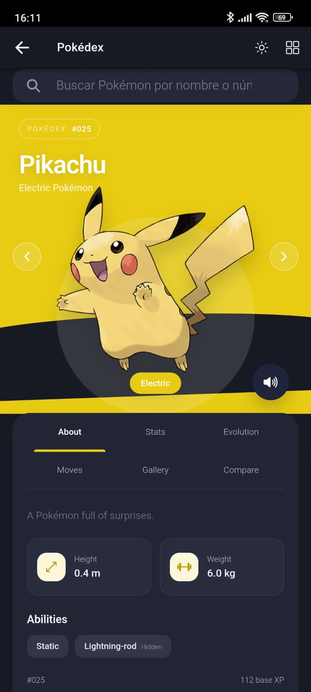
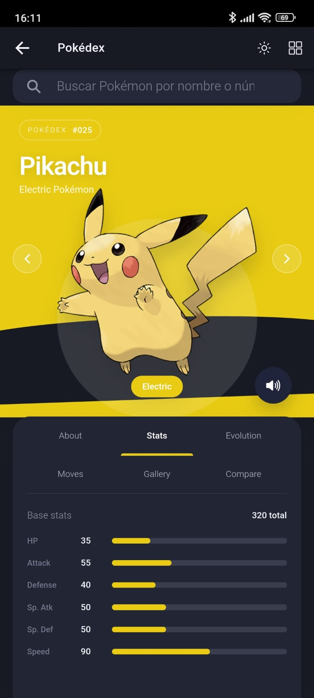
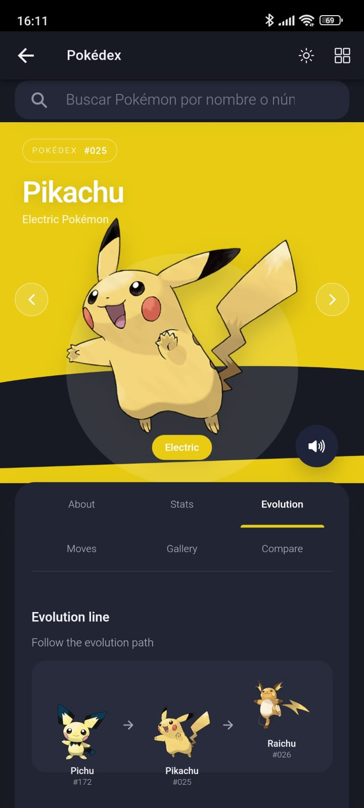
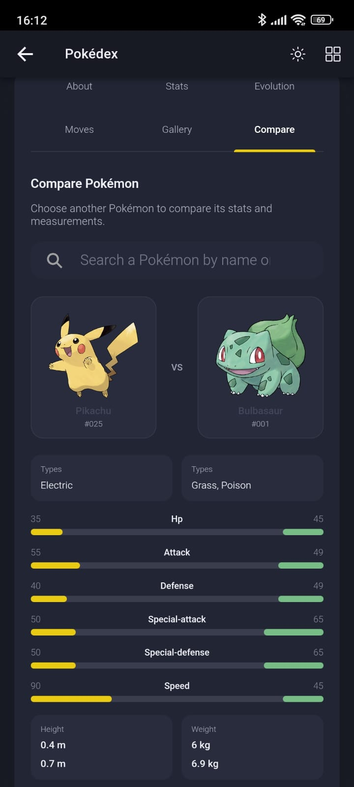
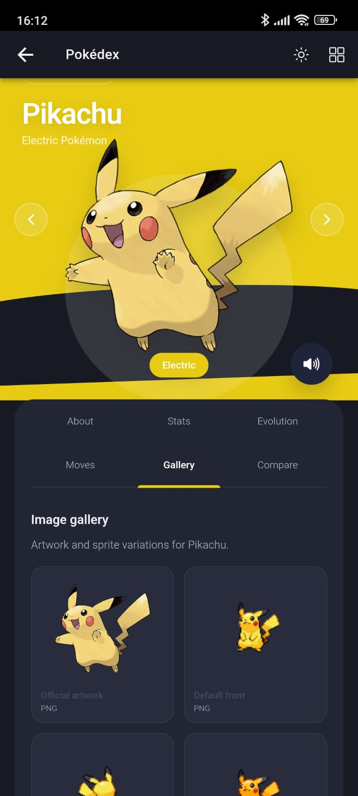
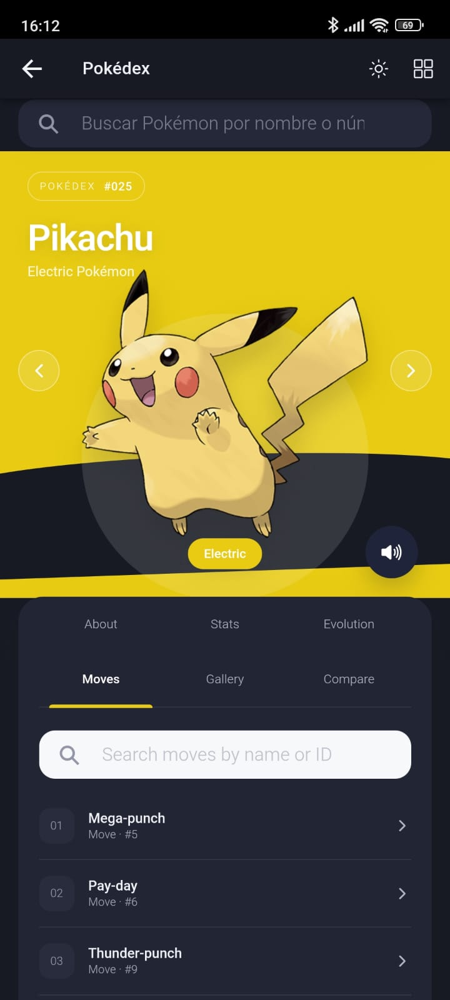

# Pokédex móvil con Ionic y Angular

Aplicación multiplataforma construida con **Ionic 8**, **Angular 18** y **Capacitor 6**. Consume la [PokéAPI](https://pokeapi.co/) para buscar Pokémon y consultar sus datos, movimientos, evoluciones, imágenes y gritos.

## Capturas de pantalla

Las siguientes capturas corresponden a la aplicación ejecutándose en un teléfono Android y muestran las pantallas principales en orientación vertical.

### Ficha About



### Estadísticas



### Evolución



### Movimientos



### Galería de imágenes



### Comparación de Pokémon



## Funcionalidades

- Búsqueda de Pokémon por nombre o número de Pokédex, con sugerencias seleccionables.
- Ficha de detalle con ilustración, número, tipo, altura, peso, habilidades y descripción.
- Fondo de la ficha que cambia según el tipo principal.
- Navegación al Pokémon anterior y siguiente.
- Botón de audio que reproduce el grito disponible en PokéAPI.
- Secciones **About**, **Stats**, **Evolution**, **Moves**, **Gallery** y **Compare**. En pantallas móviles estrechas, las pestañas se distribuyen en dos filas para mantenerlas visibles.
- Estadísticas base con barras visuales y valores numéricos.
- Cadena evolutiva obtenida desde la especie del Pokémon.
- Búsqueda de movimientos y ficha con tipo, categoría, potencia, precisión, PP, prioridad y descripción.
- Galería de ilustraciones y sprites disponibles; se muestra si un recurso es animado y se admiten imágenes GIF/WebP en el navegador. La cantidad depende de los recursos que PokéAPI proporcione para cada Pokémon.
- Comparación de dos Pokémon por tipo, estadísticas, altura y peso.
- Selector de tema claro/oscuro que recuerda la preferencia en el almacenamiento local del navegador.

## Tecnologías

| Tecnología | Uso |
| --- | --- |
| Ionic 8 | Componentes y diseño adaptable móvil |
| Angular 18 | Componentes, rutas y enlace de datos |
| TypeScript | Lógica de página y servicio de datos |
| SCSS | Estilos, diseño adaptable y temas |
| Capacitor 6 | Integración y ejecución en Android |
| PokéAPI v2 | Datos de Pokémon, movimientos, especies y evoluciones |

## Requisitos

- Node.js y npm instalados.
- Android Studio y SDK de Android para compilar o ejecutar en Android.
- Conexión a Internet para consultar PokéAPI y cargar sus imágenes y audios.

## Instalación y ejecución

Desde la raíz del repositorio:

```bash
npm install
npm start
```

Abre `http://localhost:4200` en el navegador. La ruta inicial redirige a la ficha de Pikachu; también se puede abrir un Pokémon por ID, por ejemplo `/pokemon-list/24` para Arbok.

Para generar la versión web de producción:

```bash
npm run build
```

Para preparar y abrir el proyecto Android:

```bash
npx cap sync android
npx cap open android
```

Desde Android Studio se puede seleccionar un emulador o dispositivo conectado y ejecutar la app. Para probar en un teléfono físico, habilita la depuración USB y autoriza el equipo desde el dispositivo.

## Prueba manual en móvil

La adaptación de pestañas se corrigió para que **Compare** también sea visible en orientación vertical. Antes de entregar, valida en el teléfono:

1. Busca un Pokémon por nombre y por número, y abre el resultado.
2. Cambia entre las seis pestañas con el teléfono en vertical y horizontal.
3. Comprueba el tema claro/oscuro, incluida la persistencia tras cerrar y volver a abrir la app.
4. Reproduce el grito y revisa las imágenes disponibles en Gallery.
5. Abre un movimiento y compara dos Pokémon.

Las capturas documentan la ejecución en un teléfono Android. La lista sirve para repetir y validar cada interacción después de realizar cambios.

## Organización del código

```text
src/app/
├── app-routing.module.ts                 # Rutas de la aplicación
├── app.module.ts                          # Módulo raíz y HttpClient
├── services/
│   └── pokemon.service.ts                 # Acceso a PokéAPI y datos normalizados
└── pages/pokemon-list/
    ├── pokemon-list.page.ts               # Carga, búsqueda, audio y navegación
    ├── pokemon-list.page.html             # Plantilla Ionic y pestañas
    ├── pokemon-list.page.scss             # Diseño adaptable y temas
    └── pokemon-list.module.ts              # Módulo de la página
```

## Servicio y endpoints

El servicio Angular consulta `https://pokeapi.co/api/v2` y expone, entre otros:

- `getPokemons(limit, offset)`: catálogo para las sugerencias de búsqueda.
- `getPokemonDetails(nameOrId)`: datos generales del Pokémon.
- `getPokemonSpecies(nameOrId)` y `getResource(url)`: especie y cadena evolutiva.
- `getPokemonGallery(nameOrId)`: variantes de imágenes disponibles y formato.
- `getMoveDetails(nameOrId)`: información detallada de un movimiento.
- `comparePokemons(first, second)`: datos y estadísticas alineadas para comparar.

La aplicación consulta la API directamente desde el cliente; este repositorio no incluye un servidor backend propio.

## Estado de validación

`npm run build` compila correctamente. Este README incluye capturas de las pantallas principales tomadas en un teléfono Android.
